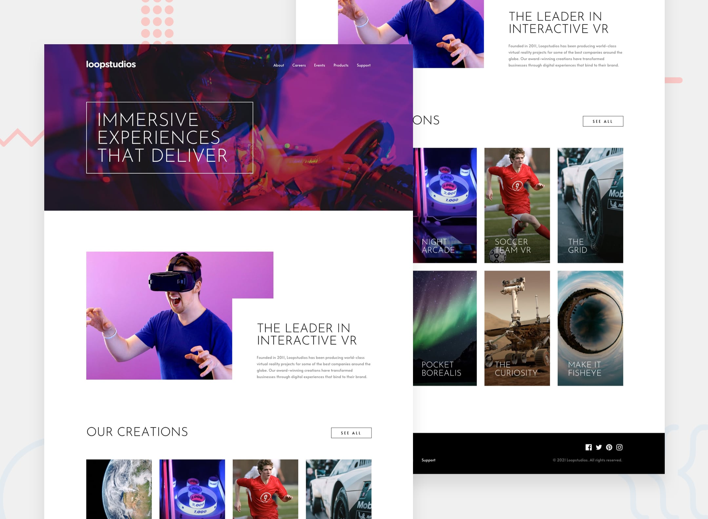

# Frontend Mentor - Loopstudios landing page solution

This is a solution to the Loopstudios landing page challenge on Frontend Mentor. Frontend Mentor challenges help you improve your coding skills by building realistic projects.

## Table of contents

- Overview
  - The challenge
  - Screenshot
  - Links
- My process
  - Built with
  - What I learned
  - Continued development
  - Useful resources
  - AI Collaboration
- Author

## Overview

### The challenge

Users should be able to:

- View the optimal layout for the site depending on their device's screen size
- See hover states for all interactive elements on the page

### Screenshot



### Links

- Solution URL: [Repository](https://github.com/jonghwascript/loopstudios-landing-page)
- Live Site URL: [Live site](https://jonghwascript.github.io/loopstudios-landing-page/)

## My process

### Built with

- Semantic HTML5 markup
- SCSS with BEM-style class names (`c-` components, `l-` layouts, `u-` utilities)
- CSS custom properties
- Flexbox and CSS Grid
- Mobile-first workflow with `em`-based media queries
- Vanilla JavaScript (ES modules)

### What I learned

#### 1. Semantic HTML and accessible names

- The site `<header>` only becomes a `banner` landmark when it is not inside `<main>`, so the header sits before `<main>` and the hero image is handled in CSS.
- `<picture>` sources follow the mobile-first SCSS: the desktop image uses `media="(min-width: 64em)"`, not `max-width`.
- Text in the markup is written in normal case and uppercased with `text-transform`. Screen readers, copied text, and reader modes get "Our creations" instead of "OUR CREATIONS".
- Card titles split into two lines with `<span>`s need a space between them. Without it, the link name is computed as "DEEPEARTH".
- A link that only says "See all" gets visually hidden context, so it still makes sense in a list of links:

```html
<a class="c-creations__see-all" href="#"
  >See all<span class="u-sr-only"> creations</span></a
>
```

- The logo in the open menu panel repeats the header logo, so it uses `alt=""` to avoid being announced twice.
- A skip link is the first element in `<body>` and becomes visible on focus.

#### 2. A mobile menu panel without horizontal scroll

My first attempt moved the whole fixed panel off-screen with `transform: translateX(100%)`. That created about 300px of horizontal scroll at 375px. A `position: fixed` element that overflows the viewport is still part of the scrollable area, and `overflow-x: hidden` on `html` or `body` does not clip it.

The fix was to split the panel into a frame that stays inside the viewport and an inner part that slides:

```scss
.c-nav-panel {
  position: fixed;
  inset: 0;
  overflow-x: hidden; // clip the sliding part
  overflow-y: auto; // let short landscape screens scroll the menu
  visibility: hidden; // closed: out of the tab order and accessibility tree
  transition: visibility 0s linear var(--nav-panel-duration, 0.3s);

  &.is-open {
    visibility: visible;
    transition-delay: 0s; // visible immediately so focus can move inside
  }

  &__inner {
    min-block-size: 100%;
    padding: var(--nav-panel-padding, 40px 24px);
    background-color: var(--nav-panel-bg, #000);
    transform: translateX(100%);
    transition: transform var(--nav-panel-duration, 0.3s) ease-out;
  }

  &.is-open &__inner {
    transform: none;
  }
}
```

Other lessons from the panel:

- The background and padding belong on the moving part. On the frame, the padding let the hero image show through and a strip appeared before the slide.
- `transform` alone only moves things visually. Closed menu links still received keyboard focus until I added `visibility: hidden`.
- The delayed `visibility` transition keeps the slide-out animation, and resetting the delay on open lets JavaScript move focus into the panel right away.
- On desktop, both the frame and the inner part must be reset. I first forgot the inner `transform`, so the desktop links sat just off the right edge, still focusable, and caused horizontal scroll.

#### 3. Menu behavior and focus management in JavaScript

The menu logic lives in a reusable `initNavPanel(root, { desktopQuery })` function. It is wired through `data-nav-*` attributes instead of class names, so other projects can reuse it with their own BEM classes.

- Opening sets `aria-expanded="true"` and moves focus to the close button with `focus({ preventScroll: true })`. A plain `focus()` scrolled the panel and cancelled the slide.
- While the menu is open, everything behind the panel is made `inert`, so Tab and screen readers stay inside the menu. The targets are computed from the DOM: the siblings of each ancestor of the panel, up to `<body>`.

```js
function collectBackground(panel) {
  const elements = [];
  for (let node = panel; node && node !== document.body; node = node.parentElement) {
    const parent = node.parentElement;
    if (!parent) break;
    for (const sibling of parent.children) {
      if (sibling !== node && !['SCRIPT', 'STYLE', 'TEMPLATE'].includes(sibling.tagName)) {
        elements.push(sibling);
      }
    }
  }
  return elements;
}
```

- When closing, `inert` has to be removed before focus returns to the hamburger button. An inert button cannot receive focus.
- `inert` cannot go on the whole `<header>`, because the menu is inside it and a descendant cannot opt out. Moving the menu out of the header would remove it from the `banner` landmark.
- The menu closes with the close button, `Escape`, or a menu link.
- If the viewport crosses the desktop breakpoint while the menu is open, the menu resets to closed. An `is-resizing` class turns off transitions for two animation frames so the panel does not visibly slide away.
- Under `prefers-reduced-motion: reduce`, the panel opens and closes without sliding.

#### 4. Supporting 200% text size

- The `mq()` mixin converts the px breakpoints to `em`, so breakpoints move when the browser's default font size changes:

```scss
@media (min-width: math.div(map.get(v.$breakpoints, $device), 16px) * 1em) {
  @content;
}
```

- The hero row uses `minmax(650px, auto)` instead of a fixed height, and the hero `<picture>` uses `contain: size` so the image's intrinsic height (1300px) does not stretch the row.
- On desktop the hero title is placed in the grid instead of being absolutely positioned. An absolutely positioned title was clipped above the hero at 200% text.
- The title reserves space for the header with `margin-block: calc(40px + 4rem)`. At 100% it stays centered, and larger text pushes it below the header instead of overlapping it.
- Long words wrap with `overflow-wrap: anywhere` instead of overflowing at 320px.
- Font sizes are in `rem`. My first version used px presets for body text, menus, card titles, and the footer, so only the headings grew when I raised the browser's default font size. Spacing that belongs to a piece of text uses `em`, so it grows with that text:

```scss
$font-size-preset6: 0.9375rem; // was 15px

&__see-all {
  font-size: $font-size-preset7; // 0.875rem
  padding-block: 0.9286em; // 13px at 14px
  padding-inline: 2.8929em; // 40.5px at 14px
}
```

- Fluid sizes keep a `rem` part in the preferred value, such as `clamp(2.5rem, calc(0.5916rem + 8.142vw), 4.5rem)`. A px constant there does not follow the font setting.
- Borders, outlines, touch targets, and image heights stay in px because they do not depend on text size.
- At 200% text the footer menu no longer fits in half of the footer. The footer columns size to their content with `repeat(2, auto)`, and the menu wraps with `flex-wrap: wrap` instead of overlapping the copyright line.

#### 5. Contrast for text over images

I measured the background pixels behind each piece of text, not just the colors in the design.

- White card titles had no overlay and dropped to about 1:1 on light images. A bottom gradient fixed this. On mobile and tablet the cards are only 120px tall, so the titles sit mid-gradient. The design gradient left "Night Arcade" at 3.45:1.
- A percentage-based gradient also failed once the text was larger. At 200% text, the two-line titles reached the transparent top of the gradient and dropped to about 1:1. Below the desktop breakpoint, the gradient stops are now in `em`, based on the title's font size, so the dark area grows with the title:

```scss
&__item::after {
  font-size: $font-size-preset6; // same size as the card title
  background: linear-gradient(
    to top,
    rgba(0, 0, 0, 0.8) 0,
    rgba(0, 0, 0, 0.75) 5em,
    rgba(0, 0, 0, 0) 8em
  );
}
```

  On mobile and tablet the lowest title contrast is now 10.71:1 at 100% text and 10.86:1 at 200% text. Desktop cards are 450px tall and keep the design gradient (lowest 7.46:1, or 7.28:1 at 200% text).
- On desktop, the white navigation links sat on a bright pink part of the hero image at about 2.8:1. The desktop design has no overlay there, but I added a 40% black overlay on desktop only. That brings the links to 6.71:1 and the large title to at least 3.76:1. Mobile and tablet follow the design without an overlay and still pass.
- The hero title needs `position: relative; z-index: 1`. Once the `<picture>` is positioned for its overlay, it paints above the title in the same grid cell.

#### 6. Hover and focus states

- A nested SCSS selector compiled to a class that did not exist:

```scss
.c-creations {
  &__item {
    // compiles to .c-creations__item__link:hover — matches nothing
    &__link:hover .c-creations__card-title { color: $bg-black; }
  }
}
```

  The overlay changed on hover, but the white title stayed white on the white overlay. Moving the rule up one level fixed it.

- `:focus-within` and `:focus-visible` behave differently after a mouse click. The overlay used `:focus-within` and the title color used `:focus-visible`. After clicking a card, the link kept focus, so the white overlay stayed while the title turned white again. Both now use the same conditions:

```scss
&__item {
  &:hover::after,
  &:has(.c-creations__link:focus-visible)::after {
    background: rgba(255, 255, 255, 0.75);
  }
}

&__link:hover .c-creations__card-title,
&__link:focus-visible .c-creations__card-title {
  color: $bg-black;
}
```

- The social links contain only an icon and visually hidden text, so `text-decoration: underline` had nothing visible to draw under. The hover and focus line is a `::after` element instead.
- Keyboard focus gets the same feedback as hover. For example, SEE ALL inverts on both, plus an offset outline on focus.
- Small icon buttons get a 44×44px touch area with padding, and the same negative margin keeps the icon in place:

```scss
&__button {
  padding: 14px 10px;
  margin: -14px -10px;
}
```

  The social icons are only 16px apart, so their touch areas are 40×44px to avoid overlapping.

### Continued development

- I checked layout, focus order, contrast, and menu behavior in Chromium only. Firefox, real screen readers, Windows high contrast mode, and real touch devices are still unverified.
- All links are `href="#"` placeholders because the challenge has no real destinations.
- `hyphens: auto` is set on the hero title, but I did not see hyphens in the browser I tested.
- The HTML has not been checked with a validator yet.

### Useful resources

- The A11Y Project Checklist - I used it to audit the page against WCAG 2.2 A and AA.
- Every Layout - The `l-stack`, `l-cluster`, and grid layout classes are based on its patterns.

### AI Collaboration

I used Claude Code as a reviewer and pair programmer.

- **Reviews:** It compared the code against my semantic HTML and accessibility checklists and reported issues with the file location, evidence, and impact.
- **Measurement:** It ran Playwright scripts in Chromium to measure overflow, focus order, contrast behind text, and behavior at 200% text size. This is how the off-screen desktop menu, the nested selector bug, and the click focus mismatch were found.
- **Refactoring:** It extracted the mobile menu into a reusable component and compared the new version against the old one to confirm the behavior stayed the same.

What worked well was asking for numbers instead of opinions, for example contrast ratios and element positions. What I still had to do myself was make design decisions, such as where to follow the design and where accessibility should win.

## Author

- Frontend Mentor - @jonghwascript
